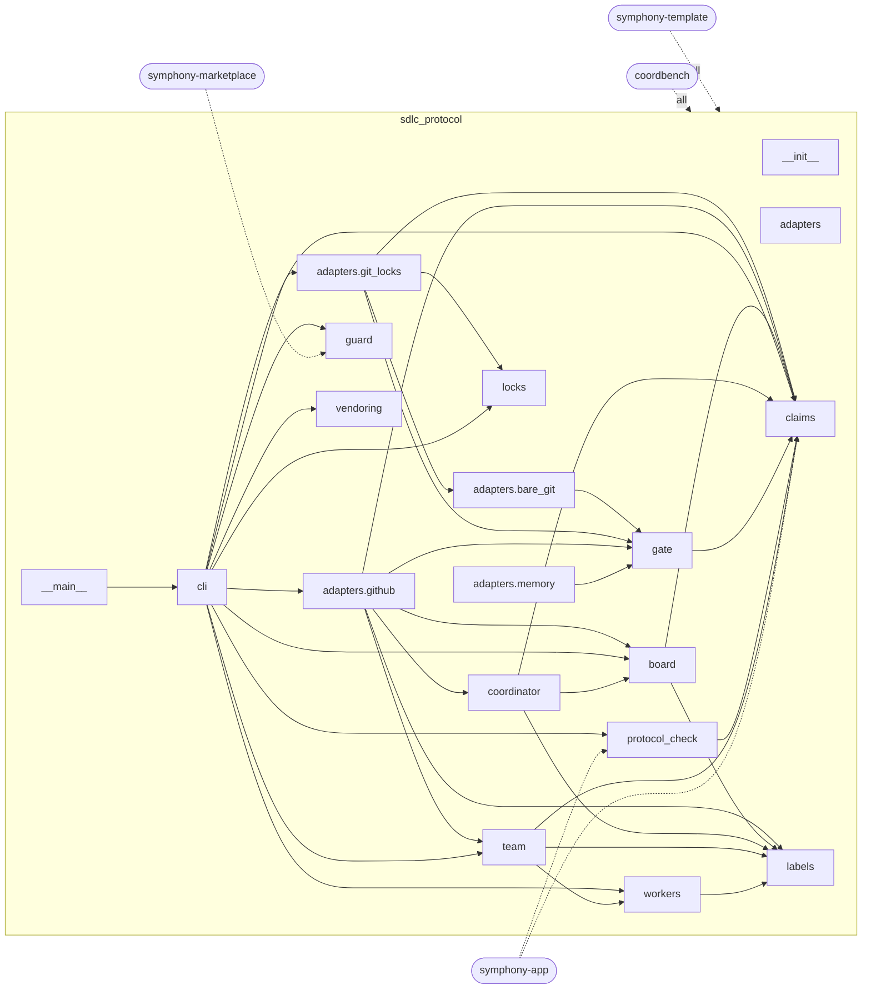
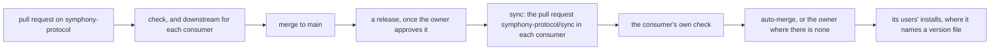

# The symphony-protocol ecosystem

Generated by `python3 scripts/architecture.py` from ecosystem.json and the package's source; change those, never this page, and regenerate it: `bash scripts/check.sh` fails while it is out of date.

The claim protocol's rules live once, in the package `sdlc_protocol` of OpenSpineConsortium/symphony-protocol. Four other repositories run a copy of it in their own tree, so their workflows and hooks need nothing but Python 3.12. ecosystem.json says which repository takes which modules and where; `scripts/vendor.py` makes each copy and records it in `VENDORED`, and each consumer's own check holds the copy to that record, so a copy is only ever changed by the sync, never by hand.

## The repositories

- **OpenSpineConsortium/symphony-protocol** (public, this repository): The claim protocol as one Python package with no dependencies: the labels, the claim, the board, the coordinator, the registry of workers, the protocol check, the clerk, the push guard and the merge gate.
- **OpenSpineConsortium/symphony-template** (internal): The template a Claude project is made from, kept as files: its instructions, its memory, its board, and the workflows and hooks that run the protocol.
- **OpenSpineConsortium/coordbench** (public): The playground and benchmark that compares ways of coordinating Claude Code agents on CooperBench's task pairs, this protocol among them.
- **OpenSpineConsortium/symphony-marketplace** (public): The Claude Code plugin marketplace whose one plugin, symphony, brings the skills, /board and the hooks to a repository not made from the template.
- **OpenSpineConsortium/symphony-app** (private): The GitHub App Symphony: its installation token starts a new copy's first workflows, and its webhook server checks pull requests.

## Who takes what

Every copy also takes `__init__.py` and `vendoring.py`: the package's version, and the check a consumer runs on its copy, `python3 <vendor_dir>/sdlc_protocol/vendoring.py verify <vendor_dir>`.

| Repository | Copy in | Modules | Uses it for | The sync's pull request merges by |
| --- | --- | --- | --- | --- |
| symphony-template | `tools/sdlc_protocol` | all of it | the board with the coordinator's releases and overlaps, the protocol check, the clerk, the registry of workers and the push guard, through the shims tools/board.py, check_protocol.py, team.py, workers.py and guard_push.py | auto-merge, once its check is green |
| coordbench | `coordbench/vendor/sdlc_protocol` | all of it | the sdlc arm's merge gate and the bare-git world (sdlc_protocol.gate and sdlc_protocol.adapters.bare_git, in coordbench/arms/sdlc/arm.py) | auto-merge, once its check is green |
| symphony-marketplace | `plugins/sdlc/vendor/sdlc_protocol` | `guard.py` | the push guard in the plugin's PreToolUse hook (plugins/sdlc/scripts/guard.py) | auto-merge, once its check is green |
| symphony-app | `app/vendor/sdlc_protocol` | `claims.py`, `protocol_check.py` | the protocol check, posted as the check run sdlc/protocol (app/handlers.py) | auto-merge, once its check is green |

A consumer that ships its copy on to users of its own names a version file in ecosystem.json. Whenever the copy's files change, `scripts/vendor.py` raises that file's patch version in the same run, so the sync's commit is also the release that takes the new copy to those users: Claude Code, for one, keeps an installed plugin on its cached copy until the version in the plugin's manifest changes.

- symphony-marketplace: `plugins/sdlc/.claude-plugin/plugin.json`

## The modules and who takes them

A solid arrow is an import, from the module that imports to the module it needs; a dotted arrow is a repository taking the whole package or the modules it names. The rules are plain functions over what they are handed; only the modules under `adapters/` call GitHub or change a git repository, and `cli` is the shell around them.

What each module is, in the first sentence of its docstring:

- `__init__`: The claim protocol for pull-request-gated Claude agents, as one package.
- `__main__`: python3 -m sdlc_protocol: the package's command line, in cli.py.
- `adapters`: The worlds the merge gate decides over, one module each.
- `adapters.bare_git`: The world over a bare repository: the gate's merges made with git itself.
- `adapters.git_locks`: The lock table's git side: reading LOCKS.json from the branch `locks`, writing a new table as one commit on the tip it read, and pushing it, with the claim branch beside it when the locks are taken at the claim.
- `adapters.github`: The protocol over GitHub's REST API, through urllib.
- `adapters.memory`: A world held in memory, for tests and simulations of the merge gate.
- `board`: The board: what a repository's open work looks like, as one page.
- `claims`: The claim: a branch named for an issue and the file that describes it.
- `cli`: The command line: python3 -m sdlc_protocol `<board|check|team|workers|guard|verify-vendored>`.
- `coordinator`: The coordinator's rules: which claims to release and what to say when it does, and what to tell open work that meets other work in the same files.
- `gate`: The merge gate: the claim protocol's decisions as a policy over a world.
- `guard`: Refuse a git push the board rules forbid, before it runs.
- `labels`: The labels the claim protocol reads and writes.
- `locks`: Locks on files, on parts of files and on named resources, kept in git.
- `protocol_check`: Hold a `claude/<issue>` pull request to the claim protocol.
- `team`: The clerk: the clerical work of the coordinator and the workers, done by code so no Claude usage goes to it.
- `vendoring`: The record a vendored copy of this package carries, and its check.
- `workers`: The workers a repository runs, kept as files: one small JSON file per worker under .github/symphony/workers/, named for the worker.

## How a change travels

1. A pull request here runs the check named `check`, the library's own suite, and one `downstream (<consumer>)` job per consumer: the change vendored into a checkout of that consumer and the consumer's own check run on it, so a change that would break one is red before it merges.
2. The owner merges it to main. Where it raises the version, its merge is a release: `.github/workflows/release.yml` tags it and publishes it once the owner approves the run in the environment `release`, and not before.
3. The sync workflow (`.github/workflows/sync.yml`) follows each Release run that succeeds, and runs weekly and by hand; every run carries the newest published release, never main's head, into each consumer (symphony-template, coordbench, symphony-marketplace, symphony-app) with that release's own `scripts/vendor.py`, and opens the pull request `symphony-protocol/sync` there, or updates the one already open, with the GitHub App's token, so the consumer's own CI runs on it; where the consumer's main already holds the copy, it closes a sync pull request still open there. Where a consumer names a version file (symphony-marketplace's `plugins/sdlc/.claude-plugin/plugin.json`), the same commit raises its patch version whenever the copy's files change.
4. The consumer's own check runs on that pull request; part of it is `vendoring.py verify`, which holds the copy to its record.
5. Where ecosystem.json gives a consumer auto_merge, its pull request lands by auto-merge once that check is green; the others wait for their owner.
6. Where the consumer names a version file, that merge is also its release: the installs that run its copy see the new version and take the new copy at their next update.

A consumer never edits its copy: the change is made here and comes back with the next release, by the sync. To vendor by hand, `python3 scripts/vendor.py <consumer checkout>` from a clone of this repository.

A change a consumer must answer, such as a rendered string its test pins or a function it calls differently, turns that consumer's `downstream (<consumer>)` job red, and the sync cannot carry it: it rebuilds `symphony-protocol/sync` from the consumer's main on every run, so a fix pushed there is lost. The consumer goes first: this pull request raises the version from the start, a pull request of the consumer's own vendors its branch and answers the change, and merges, ahead of the release, which is the one way a change reaches a consumer before the owner's approval; the downstream job here then turns green, this pull request merges, and once the owner approves its release the sync finds that consumer up to date. README.md, "How a change reaches the other repositories", has the steps.
