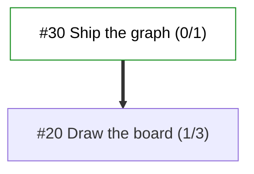
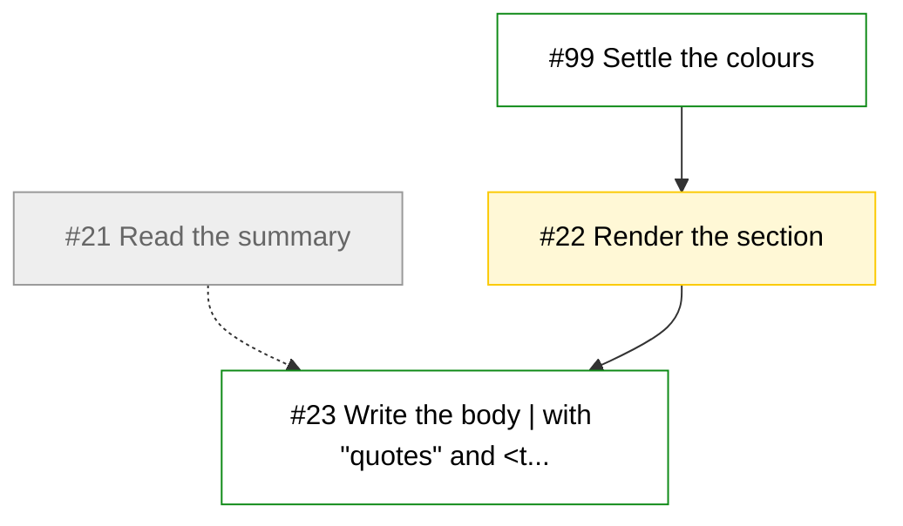

# Board

As of commit 0123abc on main. Rewritten by .github/workflows/board.yml; do not edit by hand.

## Claims (open claude/<issue> branches and docs/agents/claims/<issue>.md)

| Issue | Branch | Worker | PR | Files it touches |
| --- | --- | --- | --- | --- |
| #22 | claude/22 | alice | (no pull request yet) | sdlc_protocol/board.py |

## Open pull requests

| PR | Title | Branch | State (clean, behind, conflicting, blocked, unknown) | Last update |
| --- | --- | --- | --- | --- |
| (none) |  |  |  |  |

## Overlaps (files that more than one piece of open work changes; land the work in this order: a blocker first, then work marked ready, then the oldest)

| File | Open work, in the order it should land |
| --- | --- |
| (none) |  |

## Queue (open issues labelled todo, unclaimed and given to no worker)

| Issue | Title | Labels |
| --- | --- | --- |
| #23 | Write the body \| with "quotes" and <tags> #5 and a title long enough to be cut short (blocked by #22) | todo |
| #99 | Settle the colours | todo |

## Given to workers (open issues a worker's label names, not yet claimed)

| Issue | Title | Worker |
| --- | --- | --- |
| #24 | Write the docs (blocked by 2 open issues) | bob |

## Blockers (open issues labelled blocker)

| Issue | Title | Labels |
| --- | --- | --- |
| #25 | Fix the build (blocked by 1 open issue) | blocker |

## Recently merged (the last 5)

| PR | Title | Branch | Merged |
| --- | --- | --- | --- |
| (none) |  |  |  |

## Dependencies

Each open epic's tasks as GitHub's sub-issues and blocked-by relations hold them: an arrow runs from the issue that blocks to the issue it blocks, dotted once the blocker is closed; a node's shade is its state, and an epic's heading counts its closed tasks.

### Goals

### Epic #20: Draw the board (1/3)

